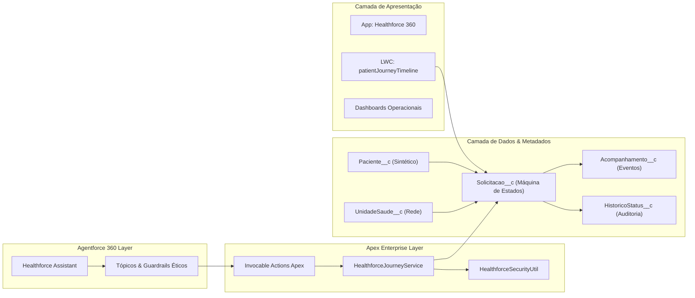

# Healthforce 360 🏥⚡
> **Plataforma Inteligente de Gestão e Jornada Administrativa do Paciente com Salesforce & Agentforce 360**

[](https://developer.salesforce.com/)
[](https://www.salesforce.com/agentforce/)
[](https://developer.salesforce.com/)
[](https://developer.salesforce.com/docs/platform/lwc/guide)
[](https://www.planalto.gov.br/ccivil_03/_ato2015-2018/2018/lei/L13709compilado.htm)
[](https://en.wikipedia.org/wiki/Design_science_research)

---

## 📋 1. Visão Geral do Projeto

O **Healthforce 360** é um projeto de pesquisa aplicada e artefato de engenharia de software desenvolvido para demonstrar como os recursos avançados da plataforma **Salesforce** e do **Agentforce 360** podem governar, desfragmentar e monitorar a jornada administrativa do paciente na rede de saúde.

A solução atua desde o acolhimento e cadastro em uma Unidade Básica de Saúde (UBS) até o encaminhamento especializado, agendamento de exames e encerramento, preservando **rastreabilidade estrita**, **segurança**, **controle de acesso** e **supervisão humana**.

> ⚠️ **Aviso Regulatório e Ético**: O Healthforce 360 é um protótipo experimental de gestão administrativa. **Não é um prontuário eletrônico clínico**, não realiza diagnósticos, não substitui regulação pública médica oficial e opera exclusivamente com **dados sintéticos e fictícios** em conformidade rigorosa com a **LGPD (Lei nº 13.709/2018)** e as diretrizes do **Programa SUS Digital (Portaria GM/MS nº 3.232/2024)**.

---

## 🚀 2. Destaques da Solução & Capacidades

- **Governança Estrita de Ciclo de Vida**: Máquina de estados finitos em Apex Trigger Handler garantindo fluxo controlado: `Aberta` &rarr; `Em análise` &rarr; `Pendente` / `Encaminhada` &rarr; `Concluída` / `Cancelada`.
- **Trilha Indelével de Auditoria**: Registro automático em `HistoricoStatus__c` com autoria, carimbo temporal, status anterior e justificativa mandatória.
- **Agentforce 360 Autônomo e Supervisionado**:
  - Tópicos dedicados para consultas de status e acompanhamentos.
  - Ações Invocáveis determinísticas em Apex (`@InvocableMethod`).
  - Flag de auditoria `RegistradoPorAgentforce__c = true` para diferenciar ações humanas de ações da IA.
  - Guardrails rígidos no prompt instruindo o agente a recusar aconselhamento clínico ou médico.
- **Interface Moderna em LWC (`patientJourneyTimeline`)**: Linha do tempo interativa e responsiva construída com o *Salesforce Lightning Design System (SLDS)*, destacando SLA em tempo real (Em Dia, Atenção, Vencido).
- **Arquitetura Baseada no Salesforce Well-Architected Framework**: Camada de serviço desacoplada (`Clean Architecture`), validação preventiva de FLS/CRUD via `Security.stripInaccessible` e controle granular por Permission Sets.

---

## 🏛️ 3. Diagrama de Arquitetura



---

## 📂 4. Estrutura do Repositório

```text
healthforce360/
├── config/
│   └── project-scratch-def.json            # Configuração de Scratch Org Developer
├── data/
│   ├── seed-data.apex                      # Carga automatizada de dados sintéticos
│   ├── UnidadeSaude__c.csv                 # Unidades de saúde simuladas
│   └── Paciente__c.csv                     # Pacientes sintéticos anonimizados
├── docs/
│   ├── adr/
│   │   ├── ADR-001-Custom-Objects-vs-Standard-Case.md # Decisão de objetos customizados
│   │   └── ADR-002-Agentforce-Guardrails-and-Invocable-Actions.md # Guardrails de IA
│   ├── architecture-diagram.md             # Diagramas e princípios
│   └── data-dictionary.md                  # Dicionário de dados completo
├── force-app/main/default/
│   ├── agentforce/
│   │   ├── AGENTFORCE_PLAYBOOK.md          # Especificação de tópicos e guardrails
│   │   └── agent-definition.json           # Definição do agente para Einstein Studio
│   ├── applications/
│   │   └── Healthforce_360.app-meta.xml    # App Lightning corporativo
│   ├── classes/
│   │   ├── HealthforceSecurityUtil.cls     # Sanitização FLS/CRUD & 'with sharing'
│   │   ├── HealthforceJourneyService.cls   # Camada de domínio de negócio
│   │   ├── AgentforceConsultarStatusAction.cls       # Invocable Action para Agentforce
│   │   ├── AgentforceRegistrarAcompanhamentoAction.cls # Invocable Action de registro
│   │   ├── AgentforceConsultarPendenciasAction.cls     # Invocable Action de gargalos
│   │   ├── SolicitacaoTriggerHandler.cls   # Governança de estados e histórico
│   │   ├── SolicitacaoTriggerTest.cls      # Testes da máquina de estados (>95%)
│   │   └── AgentforceServiceTest.cls       # Testes das ações do Agentforce (>95%)
│   ├── triggers/
│   │   └── SolicitacaoTrigger.trigger      # Trigger em Solicitacao__c
│   ├── lwc/
│   │   └── patientJourneyTimeline/         # LWC da linha do tempo da jornada
│   ├── objects/
│   │   ├── Paciente__c/
│   │   ├── UnidadeSaude__c/
│   │   ├── Solicitacao__c/
│   │   ├── Acompanhamento__c/
│   │   ├── HistoricoStatus__c/
│   │   └── RegraFluxo__mdt/
│   └── permissionsets/
│       ├── Healthforce_Atendimento.permissionset-meta.xml
│       ├── Healthforce_Gestor.permissionset-meta.xml
│       └── Healthforce_Agentforce.permissionset-meta.xml
├── linkedin/
│   └── POST_LINKEDIN.md                    # Post de divulgação estruturado para LinkedIn
├── scripts/
│   ├── deploy.ps1                          # Automação de deploy para Windows PowerShell
│   ├── deploy.sh                           # Automação de deploy para Linux/macOS
│   └── publish_github.ps1                  # Script de versionamento e push GitHub
├── sfdx-project.json                       # Configuração do Salesforce DX (API 62.0)
└── README.md
```

---

## 🛠️ 5. Como Executar e Implantar

### Pré-requisitos
1. [Salesforce CLI (`sf`)](https://developer.salesforce.com/tools/salesforcecli) instalado.
2. [Git](https://git-scm.com/) instalado.
3. Uma Salesforce Developer Edition Org ou Trailhead Playground com suporte a Lightning.

### Passo 1: Clonar o Repositório
```bash
git clone https://github.com/<SEU-USUARIO>/healthforce-360-salesforce.git
cd healthforce-360-salesforce
```

### Passo 2: Autenticar sua Org Salesforce
```bash
sf org login web -d -a HealthforceOrg
```

### Passo 3: Realizar o Deploy dos Metadados
```bash
# Via script automatizado:
./scripts/deploy.ps1     # No Windows
# ou
./scripts/deploy.sh      # No Linux/Mac

# Ou manualmente via CLI sf:
sf project deploy start --source-dir force-app
```

### Passo 4: Atribuir Permissões e Carregar Dados Sintéticos
```bash
# Atribuir Permission Set ao seu usuário administrador
sf org assign permset --name Healthforce_Gestor
sf org assign permset --name Healthforce_Agentforce

# Executar a carga de dados sintéticos de teste
sf apex run --file data/seed-data.apex
```

### Passo 5: Executar a Suíte de Testes Apex
```bash
sf apex run test --code-coverage --result-format human
```

---

## 🤖 6. Demonstração do Agentforce 360

No Salesforce Einstein 1 Studio / Agentforce Builder, configure o **Healthforce Assistant 360**:

1. **Vincular Ações**:
   - Adicione `AgentforceConsultarStatusAction` ao tópico `Consulta_Status_Jornada`.
   - Adicione `AgentforceRegistrarAcompanhamentoAction` ao tópico `Registro_Acompanhamento_Administrativo`.
   - Adicione `AgentforceConsultarPendenciasAction` ao tópico `Visao_Regulacao_Pendencias`.
2. **Exemplo de Interação Autônoma**:
   - **Usuário**: *"Qual a situação da solicitação SOL-2026-00001 da paciente Maria?"*
   - **Agentforce**: *"A solicitação SOL-2026-00001 da paciente Maria da Silva (Sintética) está com status **Encaminhada**, com destino ao Centro Especializado Santa Cruz. O prazo SLA está **Em Dia** (4 dias decorridos)."*
   - **Usuário**: *"Registre que a paciente compareceu para confirmar o agendamento."*
   - **Agentforce**: *"Acompanhamento registrado com sucesso na solicitação com auditoria de agente."*

---

## 📚 7. Referências Normativas e Científicas

- **BRASIL**: Lei Geral de Proteção de Dados Pessoais (LGPD), [Lei nº 13.709/2018](https://www.planalto.gov.br/ccivil_03/_ato2015-2018/2018/lei/L13709compilado.htm).
- **MINISTÉRIO DA SAÚDE**: Portaria GM/MS nº 3.232/2024 (Programa SUS Digital).
- **SALESFORCE**: [Salesforce Well-Architected Framework](https://architect.salesforce.com/docs/architect/well-architected/guide/framework.html).
- **HEVNER, A. R. et al.** (2004): Design Science in Information Systems Research. *MIS Quarterly*, v. 28, n. 1.

---

## 👥 8. Autor & Portfólio

Projeto desenvolvido como artefato de pesquisa aplicada e portfólio tecnológico em ecossistema Salesforce & IA Generativa.  
Conecte-se comigo no [LinkedIn](https://www.linkedin.com/) para acompanhar discussões sobre transformação digital em saúde e arquitetura de software!
