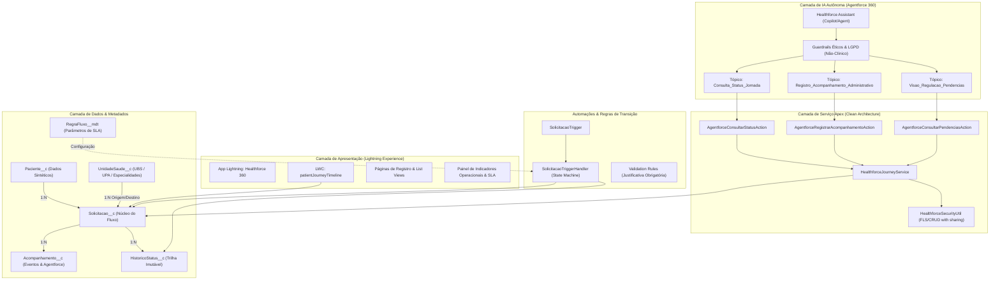

# Arquitetura Técnica - Healthforce 360

A arquitetura do **Healthforce 360** foi estruturada seguindo as diretrizes do **Salesforce Well-Architected Framework** (Trusted, Easy, Adaptable) e a metodologia **Design Science Research (DSR)**.

## Diagrama da Solução (Mermaid)

## Princípios de Arquitetura
1. **Segregação Estrita de Domínio**: Separação clara entre a jornada administrativa (agendamentos, regulação, transporte sanitário) e o prontuário eletrônico do paciente (PEP/clínico).
2. **Minimização de Dados (LGPD)**: Todos os registros criados utilizam dados inequivocamente fictícios e anônimos.
3. **Imutabilidade e Auditoria**: Cada mudança de status na máquina de estados gera um registro indelével no objeto `HistoricoStatus__c`.
4. **Agentforce com Ações Tipadas**: Agentes de IA operam através de chamadas de métodos Apex `@InvocableMethod` fortemente tipados, sem acesso a queries SQL dinâmicas irrestritas.
